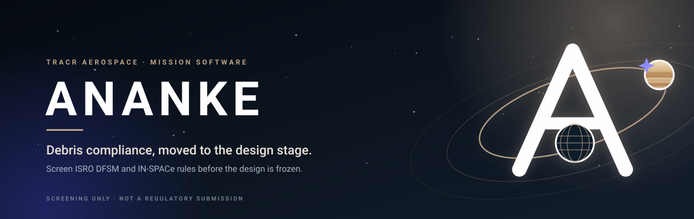
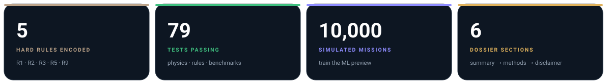
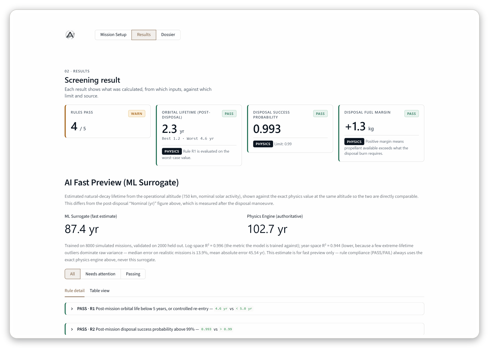
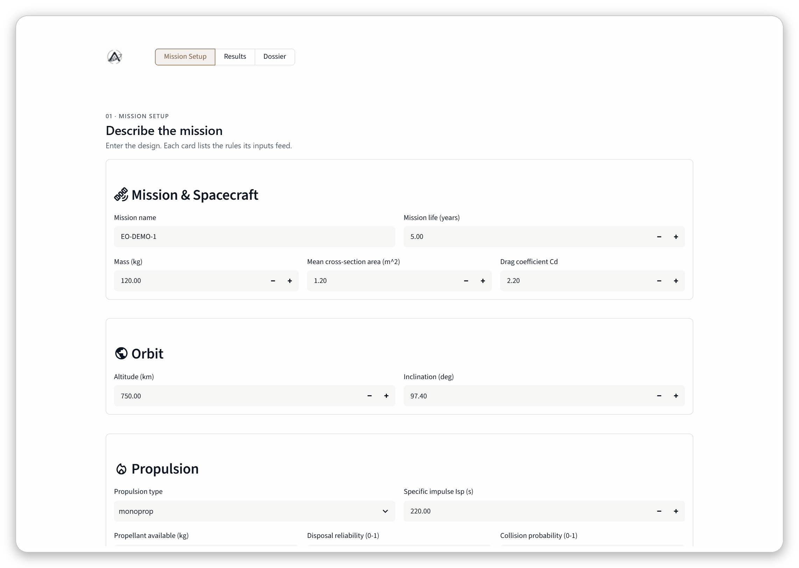
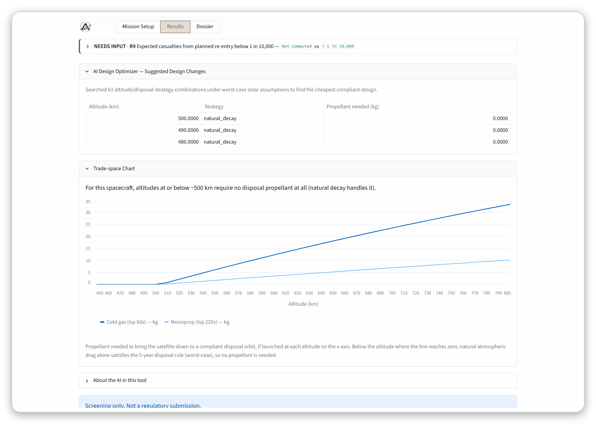
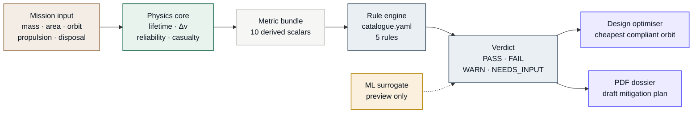

<p align="center">
  
</p>

<p align="center">
  
  
  
  
  
  
</p>

<p align="center">
  <i>Named for the Greek goddess of necessity — because debris compliance is not optional.</i>
</p>

> [!IMPORTANT]
> **Screening only.** Ananke is a design-stage planning aid, not a regulatory
> submission. Only ISRO and IN-SPACe can determine actual compliance.

**Ananke** turns a mission description into a rule-by-rule debris verdict, an
orbital-lifetime band, a propellant budget, the cheapest compliant orbit, and a
draft PDF mitigation dossier — before the design is frozen.

> **TL;DR** — Describe a satellite. Get a verdict against ISRO DFSM and IN-SPACe
> rules. Fix the orbit while it is still cheap to fix. Download the evidence.

<p align="center">
  
</p>

---

## 🛰️ Overview

India's debris rules are specific and testable. A mission must dispose within five
years (or fly a controlled re-entry), demonstrate a post-mission disposal success
probability above 99%, stay clear of the 370–430 km human-spaceflight band, budget
propellant for the disposal burn, and keep planned re-entry casualties below
1 in 10,000.

In practice those checks arrive late — after the orbit is chosen, the propellant
is fixed, and the design is expensive to change. Ananke moves them into the design
loop, so a non-compliant orbit becomes a five-second iteration instead of a
redesign.

| The old way | With Ananke |
|---|---|
| ⏳ Compliance checked after design freeze | ⚡ Checked at the altitude you are considering, right now |
| 📊 Rules in a spreadsheet, sources in an inbox | 📚 A YAML catalogue with a citation on every rule |
| 🧮 Lifetime and Δv by hand | 🧮 Deterministic physics, unit-tested against published values |
| 🧩 "Which orbit should we fly?" | 🧭 A search for the cheapest compliant design, under worst-case solar activity |
| 📄 A dossier assembled at the end | 📄 A draft PDF generated from the same run |

## 📸 Product tour

**Screening result** — four headline cards, the ML preview beside the exact
physics, and a per-rule trail with the calculation, limit, and source.



<table>
<tr>
<td width="50%" valign="top">
  
  <br/>
  <sub><b>01 · Mission setup</b> — spacecraft, orbit, propulsion, disposal plan, checklist.</sub>
</td>
<td width="50%" valign="top">
  
  <br/>
  <sub><b>03 · Design search</b> — the cheapest compliant altitude and the propellant trade space.</sub>
</td>
</tr>
</table>

## ✨ Capabilities

| | |
|---|---|
| **🛰️ Orbital lifetime**<br/>Drag-integrated decay from the post-disposal altitude, reported as a best / nominal / worst band across low, nominal, and high solar activity. | **⛽ Disposal budget**<br/>Hohmann transfer, perigee lowering, and the rocket equation — with a 20% propellant margin and a signed fuel margin in kg. |
| **🛡️ Rule engine**<br/>A data-driven catalogue with `PASS` / `FAIL` / `WARN` / `NEEDS_INPUT` outcomes, a citation for every rule, and a `warn_if` band on the lifetime rule. | **🧭 Design optimiser**<br/>Sweeps the altitude grid under worst-case solar activity and returns the cheapest compliant design — or `INFEASIBLE`, never a false pass. |
| **🤖 ML preview**<br/>A hold-out-validated random forest for instant lifetime estimates, always shown next to the exact physics value it approximates. | **📄 Draft dossier**<br/>Six sections of evidence in a PDF: summary, lifetime, compliance table, suggested changes, methods, disclaimer. |
| **🧪 Re-entry risk**<br/>Debris casualty area from surviving fragments, converted to expected casualties and blended across nominal and failure footprints. | **📚 Open methods**<br/>Every formula is visible in the source, documented in the code, and checked by the test suite — no black boxes in the compliance path. |

## ⚖️ Rule coverage

| ID | Requirement | Limit | Source |
|:--:|---|---|---|
| **R1** | Post-mission orbital life below 5 years, or controlled re-entry | worst-case lifetime `< 5 yr` | ISRO DFSM (19 Apr 2024), Guideline 4 |
| **R2** | Post-mission disposal success probability above 99% | `P_PMD > 0.99` | ISRO DFSM (19 Apr 2024), Guideline 4 |
| **R3** | Avoid transfers or disposal in the human-spaceflight band | no crossing of `370–430 km` | ISRO DFSM (19 Apr 2024), Human spaceflight band |
| **R5** | Propellant budgeted for disposal, with margin | `fuel margin ≥ 0 kg` | ISRO DFSM (19 Apr 2024), Guideline 4 / fuel budgeting |
| **R9** | Expected casualties from planned re-entry below 1 in 10,000 | `Ec < 1 × 10⁻⁴` | IN-SPACe Planned Re-entry NGP (Jul 2026), Risk limit |

<p>
  
  
  
  
</p>

**The catalogue is data, not code.** Adding a rule is a YAML entry; the engine looks
up the metric it needs. R1 carries a `warn_if` clause, so a mission that passes
only on the nominal case is flagged `WARN` rather than a clean pass. R9 is only
computed for a controlled re-entry with a re-entry plan; otherwise it honestly
reports `NEEDS_INPUT` instead of guessing.

## 🧠 How it works



| Layer | Module | Responsibility |
|---|---|---|
| **Schema** | `ananke/schema.py` | Pydantic input/output models; validates units and ranges |
| **Physics** | `ananke/physics/` | Atmosphere, lifetime, Δv, reliability, casualty — deterministic and unit-tested |
| **Metrics** | `ananke/rules/metrics.py` | Turns a mission into the 10 scalars the rules need |
| **Rules** | `ananke/rules/engine.py` + `catalogue.yaml` | Compares metrics to limits and assembles the verdict |
| **Search** | `ananke/optimise/search.py` | Cheapest compliant altitude under worst-case solar activity |
| **Preview** | `ananke/ml/surrogate.py` | Random-forest lifetime estimate — never on the compliance path |
| **Report** | `ananke/report/dossier.py` | Six-section draft PDF with methods and sources |
| **Interface** | `app/streamlit_app.py` | Setup → Results → Dossier, with the brand system applied |

## 📐 Physics, in the open

### Orbital lifetime

A circular orbit loses altitude to drag at

$$\frac{dh}{dt}=\frac{\rho(h)}{B}\sqrt{\mu\left(R_E+h\right)},\qquad B=\frac{m}{C_d A}$$

so the lifetime is the integral from re-entry altitude to the starting altitude:

$$t_{\text{life}}=\int_{h_{\text{re}}}^{h_0}\frac{dh}{\frac{\rho(h)}{B}\sqrt{\mu\left(R_E+h\right)}}$$

The integral is evaluated with a 0.5 km midpoint rule. The density comes from a
piecewise-exponential atmosphere, and the solar multiplier is the uncertainty
knob: `k = 2.0` (high activity, faster decay, best case), `k = 1.0` (nominal),
`k = 0.5` (low activity, slower decay, worst case).

### Disposal Δv and propellant

A Hohmann transfer between circular altitudes contributes two burns:

$$\Delta v=\left|v_1\left(\sqrt{\frac{2r_2}{r_1+r_2}}-1\right)\right|+\left|v_2\left(1-\sqrt{\frac{2r_1}{r_1+r_2}}\right)\right|$$

Perigee lowering uses a single burn via the vis-viva equation. Propellant follows
the Tsiolkovsky rocket equation, with a 20% margin applied to the ideal Δv:

$$m_{\text{prop}}=m_0\left(1-e^{-\Delta v/(I_{sp}g_0)}\right)$$

### Disposal reliability

$$P_{PMD}=R_{\text{disposal}}\left(1-P_{\text{collision}}\right)$$

The inverse is deliberately **not clamped**: if the required reliability exceeds
1.0, the design is not credible and the tool says so instead of faking a pass.

### Re-entry casualty risk

$$\mathrm{DCA}=\sum_i\left(0.6+\sqrt{A_i}\right)^2,\qquad E_c=\mathrm{DCA}\cdot10^{-6}\cdot\rho_{\text{eff}}$$

$$E_{c,\text{total}}=(1-p_{\text{fail}})\,E_{c,\text{nominal}}+p_{\text{fail}}\,E_{c,\text{failure}}$$

The `0.6` is the half-width of a standing person; the `1e-6` converts m² to km².

| Assumption | What is used | Why it is acceptable for screening |
|---|---|---|
| Orbit geometry | Circular only | Conservative starting point; elliptical decay is deferred |
| Atmosphere | Piecewise-exponential fit, 0.5 / 1.0 / 2.0 multipliers | Captures the solar-activity spread without a full NRLMSISE run |
| Re-entry altitude | 120 km | Standard screening convention |
| Disposal Δv | Hohmann + 20% margin | Early design budget, not a finite-burn GNC model |
| Population density | User-supplied effective density | Honest about not having a footprint grid yet |

> [!NOTE]
> These are screening models, chosen for transparency and speed. The dossier's
> methods section states them explicitly, so a reviewer can see exactly what was
> assumed.

## 🧭 The design optimiser

The optimiser answers the question every mission team actually asks: **what is the
cheapest orbit we can fly that still passes?**

1. Fix mass, area, drag coefficient, and propulsion; vary the operational altitude.
2. For each altitude, compute the worst-case lifetime (`k = 0.5`).
3. If it already decays within five years, the design needs **no burn** and zero propellant.
4. Otherwise, price a Hohmann burn down to the five-year disposal altitude, with the 20% margin.
5. Reject candidates that need more propellant than the spacecraft carries.
6. Sort by propellant, then by distance from the operator's preferred altitude.

The default search grid is 400–1000 km in 10 km steps — 61 candidates. If none is
both compliant and fuel-feasible, Ananke returns `INFEASIBLE` with a message, never
a false pass.

```text
EO-DEMO-1 · 61 candidates evaluated
status: OK
  500 km · natural_decay · 0.0 kg
  490 km · natural_decay · 0.0 kg
  480 km · natural_decay · 0.0 kg
```

## 🤖 The ML surrogate, kept honest

A 200-tree random forest is trained on **10,000 missions simulated by Ananke's own
physics**, then scored on 2,000 it never saw. Its only job is a fast lifetime
preview beside the result. It is never allowed to decide compliance.

| Metric | Value | What it means |
|---|---:|---|
| Training / hold-out | 8,000 / 2,000 | Fixed `seed=42` and `random_state=42` — fully reproducible |
| Log-space R² | **0.996** | The space the forest is trained against |
| Year-space R² | 0.944 | Diagnostic only; a few extreme lifetimes dominate raw variance |
| Median absolute percentage error | **13.9%** | The practical accuracy claim on realistic missions |
| 90th-percentile APE | 35.9% | Nine in ten hold-out cases are within this |
| Mean absolute error | 45.5 yr | Tail-sensitive, shown for completeness |

> [!TIP]
> The app shows the surrogate and the exact physics side by side at the **same
> altitude and solar condition**, so the comparison is apples to apples. The
> post-disposal lifetime card is a different altitude and is never used for that
> comparison.

## ⚡ Quickstart

**Requirements:** Python 3.10+, a terminal, and the packages in `requirements.txt`.
No API keys. The screening path runs entirely on your machine.

```bash
git clone https://github.com/lostluffyz/Ananke.git
cd Ananke

python -m venv .venv
source .venv/bin/activate        # macOS / Linux
```

```powershell
.venv\Scripts\Activate.ps1       # Windows PowerShell
```

```bash
pip install -r requirements.txt
streamlit run app/streamlit_app.py
```

Open <http://localhost:8501>. Run the app **from the repository root** — the UI
loads brand assets by relative path.

Verify the whole thing without opening a browser:

```bash
pytest -q
# 79 passed in ~38s
```

> [!TIP]
> First launch trains the surrogate once (about tens of seconds) and caches it for
> the life of the server process. Every later screening reuses the fitted model.

## 🕹️ Using the app

| Step | What you do | What you get |
|:--:|---|---|
| **01** | Enter the spacecraft, orbit, propulsion, disposal strategy, and checklist | A validated `MissionInput`; controlled re-entry reveals casualty inputs |
| **02** | Press **Run Screening** | Four headline cards: rules passed, post-disposal lifetime, `P_PMD`, fuel margin |
| **03** | Read the rule detail | Requirement, inputs, method, computed value, limit, source — and a filter for what needs attention |
| **04** | Check the design optimiser | Cheapest compliant altitude, propellant needed, and a trade-space chart |
| **05** | Open **Dossier** | A downloadable draft PDF of the current run |

## 🐍 Python API

The engine is importable without Streamlit.

```python
from ananke.rules.engine import screen_mission
from ananke.schema import MissionInput

mission = MissionInput(
    name="EO-DEMO-1",
    mass_kg=120.0,
    area_m2=1.2,
    cd=2.2,
    orbit={"type": "circular", "altitude_km": 750.0, "inclination_deg": 97.4},
    mission_life_yr=5.0,
    propulsion={
        "type": "monoprop",
        "isp_s": 220.0,
        "propellant_kg": 10.0,
        "reliability": 0.995,
    },
    p_collision=0.002,
    disposal={"strategy": "lower_to_circular", "target_alt_km": 500.0},
    checklist={"passivation": True, "trackable": True, "insurance": False},
)

output = screen_mission(mission)
for rule in output.rules:
    print(f"{rule.id:>2}  {rule.status.value:<12} {rule.value!r:>12}  limit {rule.limit!r}")
```

Ask for a better orbit:

```python
from ananke.optimise.search import find_cheapest_designs

result = find_cheapest_designs(
    mass_kg=120.0,
    cd=2.2,
    area_m2=1.2,
    isp_s=220.0,
    propellant_available_kg=10.0,
    desired_altitude_km=750.0,
)

print(result["status"])
for candidate in result["candidates"]:
    print(candidate["altitude_km"], candidate["strategy"], candidate["propellant_kg"])
```

Render the dossier:

```python
from ananke.report.dossier import generate_dossier_pdf

generate_dossier_pdf(
    mission,
    output,
    optimiser_result=result,
    output_path="ananke_dossier.pdf",
)
```

## ✅ Validation

The test suite is the credibility case, not an afterthought.
`tests/test_benchmarks.py` is written to be read on its own.

| Check | What it proves | Reference / result |
|---|---|---|
| **V1 — core formulas** | Circular speed and period at 550 km; textbook LEO→GEO Hohmann Δv | `7.585 km/s`, `95.7 min`, `3893 m/s` |
| **V5 — reliability arithmetic** | Round-trip `P_PMD` recovers 0.99; unachievable reliability is surfaced, not clamped | exact to `1e-9` |
| **V6 — rule boundaries** | A just-pass and just-fail case at every threshold, including the R1 `WARN` band | 100% |
| **V10 — no-solution case** | An oversized, fuel-starved design reports `INFEASIBLE` | never a false `PASS` |
| **NASA EUVE reference** | DCA `12.41 m²` at `15 people/km²` reproduces the published casualty figure | `≈ 1 in 5,300` |
| **ML surrogate** | 10,000 simulated missions, 8,000 train / 2,000 hold-out | log-space `R² = 0.996`, median error `13.9%` |

<details>
<summary><b>The test map — 79 tests across 10 modules</b></summary>

<br/>

| File | Covers |
|---|---|
| `test_benchmarks.py` | V1, V5, V6, V10 — the blueprint's validation IDs in one readable file |
| `test_physics.py` | Circular speed, period, ballistic coefficient, monotonic lifetime |
| `test_deltav.py` | Hohmann symmetry, perigee lowering, rocket equation |
| `test_reliability.py` | `P_PMD`, inverse reliability, validation and edge cases |
| `test_casualty.py` | Debris casualty area, the EUVE check, failure blending |
| `test_rules.py` | Catalogue loading, comparison logic, WARN behaviour, screening |
| `test_schema.py` | Pydantic validation and enum handling |
| `test_optimise.py` | Grid coverage, fuel feasibility, sorting, trade-space data |
| `test_ml_surrogate.py` | Reproducibility, hold-out bars, out-of-sample physics check |
| `test_dossier.py` | PDF generation and section presence |

</details>

## 🗂️ Project structure

```text
Ananke/
├── app/
│   └── streamlit_app.py         # setup → results → dossier, with the brand system
├── ananke/
│   ├── schema.py                # Pydantic mission input and output models
│   ├── physics/
│   │   ├── atmosphere.py        # piecewise-exponential density model
│   │   ├── lifetime.py          # drag-integrated orbital lifetime
│   │   ├── deltav.py            # Hohmann, perigee lowering, rocket equation
│   │   ├── reliability.py       # P_PMD and required reliability
│   │   └── casualty.py          # debris casualty area and expected casualties
│   ├── rules/
│   │   ├── catalogue.yaml       # the rules, with sources
│   │   ├── engine.py            # evaluate rules, assemble output
│   │   └── metrics.py           # mission → metric bundle
│   ├── ml/
│   │   └── surrogate.py         # random-forest lifetime preview
│   ├── optimise/
│   │   └── search.py            # cheapest compliant design
│   └── report/
│       └── dossier.py           # six-section draft PDF
├── assets/
│   ├── readme/                  # hero and stat graphics
│   ├── screenshots/             # UI captures used here
│   └── *.png, *.svg             # Ananke and Tracr brand kit
├── tests/                       # 79 tests, including the benchmark suite
├── requirements.txt
├── .streamlit/config.toml       # light theme, brand palette
└── README.md
```

## 🧱 Engineering decisions

| Decision | Why |
|---|---|
| **Worst-case first** | R1 is judged on the low-solar (`k = 0.5`) lifetime, so the verdict does not depend on a lucky solar cycle |
| **Rules in YAML** | The catalogue can be reviewed, cited, and extended without touching the engine |
| **Never a false pass** | Missing input becomes `NEEDS_INPUT`; no feasible design becomes `INFEASIBLE`; impossible reliability is not clamped |
| **ML off the compliance path** | The surrogate is a preview; the deterministic physics and rule engine decide every PASS/FAIL |
| **Draft by construction** | The PDF carries the disclaimer on page one and in the appendix, not in a footnote |
| **Reproducible by default** | Fixed seeds, fixed split, reported hold-out metrics — the same numbers on demand |

## ⚠️ Limitations

> [!WARNING]
> Ananke is a screening aid. It does not replace a mission-specific analysis, a
> launch-provider review, or a regulatory submission.

- **Circular orbits only.** Elliptical decay is not modelled; perigee lowering is
  treated as an equivalent circular altitude for the lifetime estimate.
- **Static atmosphere.** A piecewise-exponential fit with 0.5 / 1.0 / 2.0
  multipliers — not a full solar-cycle or NRLMSISE-00 model.
- **Approximate disposal Δv.** Controlled re-entry is priced as a Hohmann transfer;
  there is no finite-burn, GNC, or thermal-reentry model yet.
- **Population density is an input.** Re-entry risk uses an effective density
  supplied by the user, not a real footprint population grid.
- **Not yet benchmarked** against NASA DAS or ESA DRAMA. That comparison is on the
  roadmap, and its absence is stated in the dossier's methods section.
- **The ML surrogate never decides compliance.** Physics and the rule engine are
  the sole source of truth.

## 🗺️ Roadmap

| Stage | Item | Status |
|---|:--:|:--:|
| 1 | Physics core, five-rule engine, design optimiser | ✓ |
| 1 | ML lifetime preview with hold-out validation | ✓ |
| 1 | Draft PDF dossier | ✓ |
| 2 | Population density map (WorldPop) for re-entry footprints | — |
| 2 | Fleet and constellation screening | — |
| 2 | NASA DAS / ESA DRAMA benchmark | — |
| 2 | Elliptical-orbit decay model | — |

## ❓ FAQ

<details>
<summary><b>Is Ananke a regulatory submission?</b></summary>

No. It is a design-stage screening tool. It shows how a mission measures against
the published limits and cites the source of each rule, but only ISRO and IN-SPACe
can determine actual compliance. The dossier says this on page one.

</details>

<details>
<summary><b>Why does R9 sometimes show NEEDS_INPUT?</b></summary>

R9 is the planned re-entry casualty rule. It only applies to a controlled re-entry
with a re-entry plan (surviving components, population densities, failure
probability). For natural decay or an altitude-lowering disposal, the rule is not
applicable, and Ananke reports that honestly instead of inventing a number.

</details>

<details>
<summary><b>Why are there two R² values for the ML model?</b></summary>

Lifetime is extremely right-skewed — it spans from near zero to tens of thousands
of years. A variance-based R² on raw years is dominated by a handful of extreme
outliers and understates accuracy on realistic missions. The forest is fitted in
`log1p` space, so the log-space R² (`0.996`) is the fair fit measure. The practical
claim is the median hold-out error: `13.9%`.

</details>

<details>
<summary><b>Does the app need internet access?</b></summary>

The screening path does not: physics, optimiser, surrogate, and PDF generation all
run locally. The optional re-entry map may load basemap tiles, and the README loads
its shields.io badges over the network. No account or API key is required.

</details>

<details>
<summary><b>Can I add a rule without touching Python?</b></summary>

Yes, if the rule uses a metric the engine already computes: add an entry to
`ananke/rules/catalogue.yaml`. A brand-new metric also needs a small addition to
`ananke/rules/metrics.py` so the engine has a value to compare.

</details>

## 🧰 Stack

<p>
  
  
  
  
  
  
  
  
  
  
  
</p>

## 🏛️ Team

<table>
<tr>
<td width="150" align="center" valign="middle">
  
</td>
<td valign="middle">
  <b>Tracr Aerospace</b><br/>
  Ananke is a Tracr Aerospace mission-software project: debris compliance moved
  into the design loop for the next generation of Indian space missions.<br/><br/>
  Maintained by <a href="https://github.com/lostluffyz">@lostluffyz</a>.
</td>
</tr>
</table>

The Ananke and Tracr Aerospace marks are included in `assets/` for this project's
use.

## 📜 Disclaimer

> [!CAUTION]
> **Screening only. Not a regulatory submission.** Ananke is a design-stage
> planning aid. Its models are simplified, its outputs are indicative, and only
> ISRO and IN-SPACe can determine actual regulatory compliance.

---

<p align="center">
  
  <br/>
  <sub><b>ANANKE</b> · Screening tool, not a regulatory certificate.</sub>
</p>
