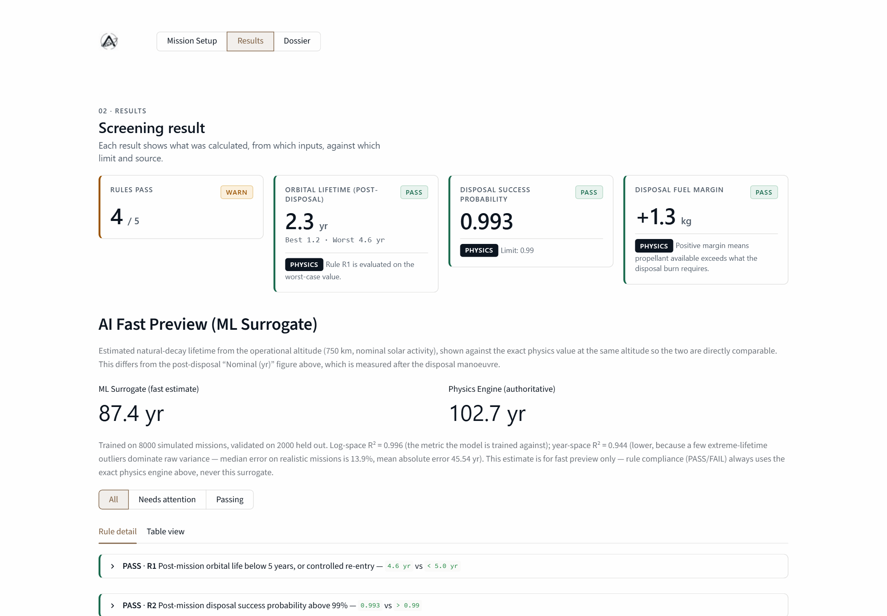
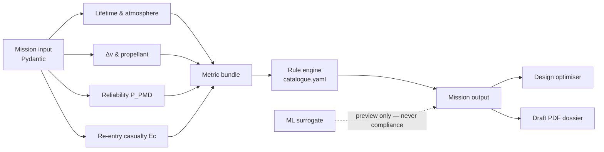
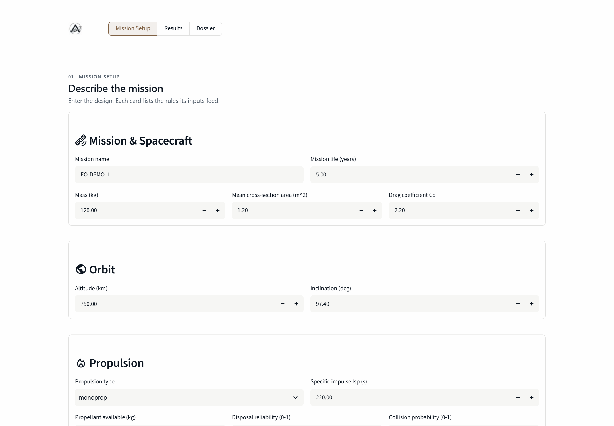
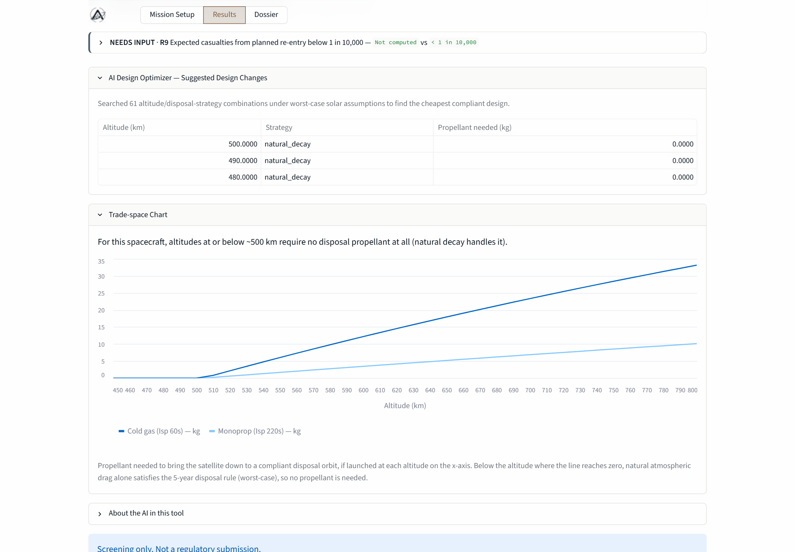

<div align="center">


# Ananke

**Design-stage debris compliance for Indian space missions.**

Screen a satellite mission against ISRO DFSM and IN-SPACe debris rules — and find
the cheapest design that passes — before the design is frozen.


</div>

<p align="center">
  
</p>

Ananke takes a mission description — mass, cross-section, orbit, propulsion, and
disposal plan — and returns an orbital-lifetime band, a rule-by-rule verdict with
source citations, a propellant margin, the cheapest compliant altitude, and a
draft PDF mitigation dossier.

> **Screening only.** Ananke is a design-stage planning aid, not a regulatory
> submission. Only ISRO and IN-SPACe can determine actual compliance.

---

## Why Ananke

India's debris rules are specific and testable: dispose within five years (or fly
a controlled re-entry), demonstrate a post-mission disposal success probability
above 99%, stay clear of the 370–430 km human-spaceflight band, budget propellant
for the disposal burn, and keep planned re-entry casualties below 1 in 10,000.

In practice those checks arrive late — after the orbit is chosen, the propellant
is fixed, and the design is hard to change. Ananke moves them into the design
loop, so a non-compliant orbit is a five-second iteration instead of a redesign.

## What it does

| Capability | Detail |
|---|---|
| **Orbital lifetime** | Drag-integrated decay from the post-disposal altitude, reported as a best / nominal / worst band across low, nominal, and high solar activity |
| **Disposal Δv** | Hohmann transfer, perigee lowering, and the Tsiolkovsky rocket equation, with a 20% propellant margin |
| **Disposal reliability** | `P_PMD = R_disposal × (1 − P_collision)`, plus the inverse: the reliability needed to reach 99% |
| **Re-entry risk** | Debris casualty area from surviving fragments, converted to expected casualties and blended across nominal and failure-case footprints |
| **Rule engine** | A data-driven YAML catalogue with `PASS` / `FAIL` / `WARN` / `NEEDS_INPUT` outcomes and a citation for every rule |
| **Design optimiser** | Sweeps the altitude grid under worst-case solar activity and returns the cheapest compliant design — or `INFEASIBLE`, never a false pass |
| **ML preview** | A hold-out-validated random forest for instant lifetime estimates; explicitly never used for compliance |
| **Dossier** | A reportlab PDF with mission summary, lifetime estimate, compliance table, suggested changes, methods, and disclaimer |

## Rule coverage

| ID | Requirement | Limit | Source |
|:--:|---|---|---|
| **R1** | Post-mission orbital life below 5 years, or controlled re-entry | worst-case lifetime `< 5 yr` | ISRO DFSM (19 Apr 2024), Guideline 4 |
| **R2** | Post-mission disposal success probability above 99% | `P_PMD > 0.99` | ISRO DFSM (19 Apr 2024), Guideline 4 |
| **R3** | Avoid transfers or disposal in the human-spaceflight band | no crossing of `370–430 km` | ISRO DFSM (19 Apr 2024), Human spaceflight band |
| **R5** | Propellant budgeted for disposal, with margin | `fuel margin ≥ 0 kg` | ISRO DFSM (19 Apr 2024), Guideline 4 / fuel budgeting |
| **R9** | Expected casualties from planned re-entry below 1 in 10,000 | `Ec < 1 × 10⁻⁴` | IN-SPACe Planned Re-entry NGP (Jul 2026), Risk limit |

The catalogue is data, not code: adding a rule is a YAML entry, and the engine
looks up the metric it needs. R1 additionally carries a `warn_if` clause, so a
mission that passes only on the nominal case is flagged `WARN` rather than a
clean pass.

## How it works



Every compliance decision comes from the deterministic physics modules. The
surrogate sits beside the result as a fast estimate, and the UI says so.

## Screenshots

**Mission setup** — the whole mission is described in one screen.



**Design search** — the cheapest compliant altitude, and where natural decay makes
the disposal burn free.



## Quickstart

**Requirements:** Python 3.10+ and the packages in `requirements.txt`.

```bash
git clone https://github.com/lostluffyz/Ananke.git
cd Ananke

python -m venv .venv
# Windows
.venv\Scripts\activate
# macOS / Linux
source .venv/bin/activate

pip install -r requirements.txt
streamlit run app/streamlit_app.py
```

Open <http://localhost:8501>, describe the mission, and press **Run Screening**.

Run the test suite with:

```bash
pytest -q
# 79 passed
```

## Using the app

1. **Mission Setup** — enter spacecraft, orbit, propulsion, disposal strategy, and
   the qualitative checklist. Controlled re-entry reveals extra casualty inputs.
2. **Results** — read the four headline cards (rules passed, post-disposal
   lifetime, `P_PMD`, fuel margin), the ML preview beside the exact physics, and
   the per-rule detail with the calculation, limit, and source.
3. **Dossier** — generate and download a draft Space Debris Mitigation Plan PDF
   for the current run.

## Python API

The engine is importable without Streamlit:

```python
from ananke.rules.engine import screen_mission
from ananke.schema import MissionInput

mission = MissionInput(
    name="EO-DEMO-1",
    mass_kg=120.0,
    area_m2=1.2,
    cd=2.2,
    orbit={"type": "circular", "altitude_km": 750.0, "inclination_deg": 97.4},
    mission_life_yr=5.0,
    propulsion={
        "type": "monoprop",
        "isp_s": 220.0,
        "propellant_kg": 10.0,
        "reliability": 0.995,
    },
    p_collision=0.002,
    disposal={"strategy": "lower_to_circular", "target_alt_km": 500.0},
    checklist={"passivation": True, "trackable": True, "insurance": False},
)

output = screen_mission(mission)
for rule in output.rules:
    print(rule.id, rule.status.value, rule.value, rule.limit)
```

Ask for a better orbit with the optimiser:

```python
from ananke.optimise.search import find_cheapest_designs

result = find_cheapest_designs(
    mass_kg=120.0, cd=2.2, area_m2=1.2,
    isp_s=220.0, propellant_available_kg=10.0,
    desired_altitude_km=750.0,
)
print(result["status"], result["candidates"])
```

## Validation

The test suite is the credibility case, not an afterthought — `tests/test_benchmarks.py`
is written to be read on its own.

| Check | What it proves | Result |
|---|---|---|
| **V1 — core formulas** | Circular speed and period at 550 km; textbook LEO→GEO Hohmann Δv | `7.585 km/s`, `95.7 min`, `3893 m/s` |
| **V5 — reliability arithmetic** | Round-trip `P_PMD` recovers 0.99; unachievable reliability is surfaced, not clamped | exact to `1e-9` |
| **V6 — rule boundaries** | A just-pass and just-fail case at every rule threshold, including the R1 `WARN` band | 100% |
| **V10 — no-solution case** | An oversized, fuel-starved design reports `INFEASIBLE` | never a false `PASS` |
| **NASA EUVE reference** | DCA `12.41 m²` at `15 people/km²` reproduces the published casualty figure | `≈ 1 in 5,300` |
| **ML surrogate** | 10,000 simulated missions, 8,000 train / 2,000 hold-out | log-space `R² = 0.996`, median error `13.9%` |

The whole suite — **79 tests** — runs in under a minute and needs no network.

## Project structure

```text
Ananke/
├── app/
│   └── streamlit_app.py        # three-section UI: setup → results → dossier
├── ananke/
│   ├── schema.py               # Pydantic mission input and output models
│   ├── physics/
│   │   ├── atmosphere.py       # piecewise-exponential density model
│   │   ├── lifetime.py         # drag-integrated orbital lifetime
│   │   ├── deltav.py           # Hohmann, perigee lowering, rocket equation
│   │   ├── reliability.py      # P_PMD and required reliability
│   │   └── casualty.py         # debris casualty area and expected casualties
│   ├── rules/
│   │   ├── catalogue.yaml      # the rules, with sources
│   │   ├── engine.py           # evaluate rules, assemble output
│   │   └── metrics.py          # mission → metric bundle
│   ├── ml/
│   │   └── surrogate.py        # random-forest lifetime preview
│   ├── optimise/
│   │   └── search.py           # cheapest compliant design
│   └── report/
│       └── dossier.py          # draft PDF generation
├── assets/                     # brand kit and README screenshots
├── tests/                      # 79 tests, including the benchmark suite
├── requirements.txt
└── .streamlit/config.toml
```

## Limitations

Ananke is deliberately honest about its boundaries:

- **Circular orbits only.** Elliptical decay is not modelled; perigee lowering is
  treated as an equivalent circular altitude for the lifetime estimate.
- **Static atmosphere.** A piecewise-exponential fit with 0.5 / 1.0 / 2.0
  solar-activity multipliers — not a full solar-cycle or NRLMSISE-00 model.
- **Approximate disposal Δv.** Controlled re-entry is priced as a Hohmann
  transfer; there is no finite-burn, GNC, or thermal-reentry model yet.
- **Population density is an input.** Re-entry risk uses an effective density
  supplied by the user, not a real footprint population grid.
- **Not yet benchmarked** against NASA DAS or ESA DRAMA. That comparison is on the
  roadmap, and its absence is stated in the dossier's methods section.
- **The ML surrogate never decides compliance.** Physics and the rule engine are
  the sole source of truth.

## Roadmap

| Stage | Item | Status |
|---|---|:--:|
| 1 | Physics, rules, optimiser, ML preview, PDF dossier | ✓ |
| 2 | Population density map (WorldPop) for re-entry footprints | — |
| 2 | Fleet and constellation screening | — |
| 2 | NASA DAS / ESA DRAMA benchmark | — |

## Built with

`Python` · `Pydantic` · `NumPy` / `SciPy` · `pandas` · `scikit-learn` ·
`Streamlit` · `Plotly` / `pydeck` · `ReportLab` · `PyYAML` · `pytest`

## Credits

Brand identity and product direction: **Tracr Aerospace**. The Ananke and Tracr
Aerospace marks are included in `assets/` for this project's use.

Maintained by [@lostluffyz](https://github.com/lostluffyz).

---

<div align="center">
  <sub><b>Ananke</b> · Screening tool, not a regulatory certificate.</sub>
</div>
